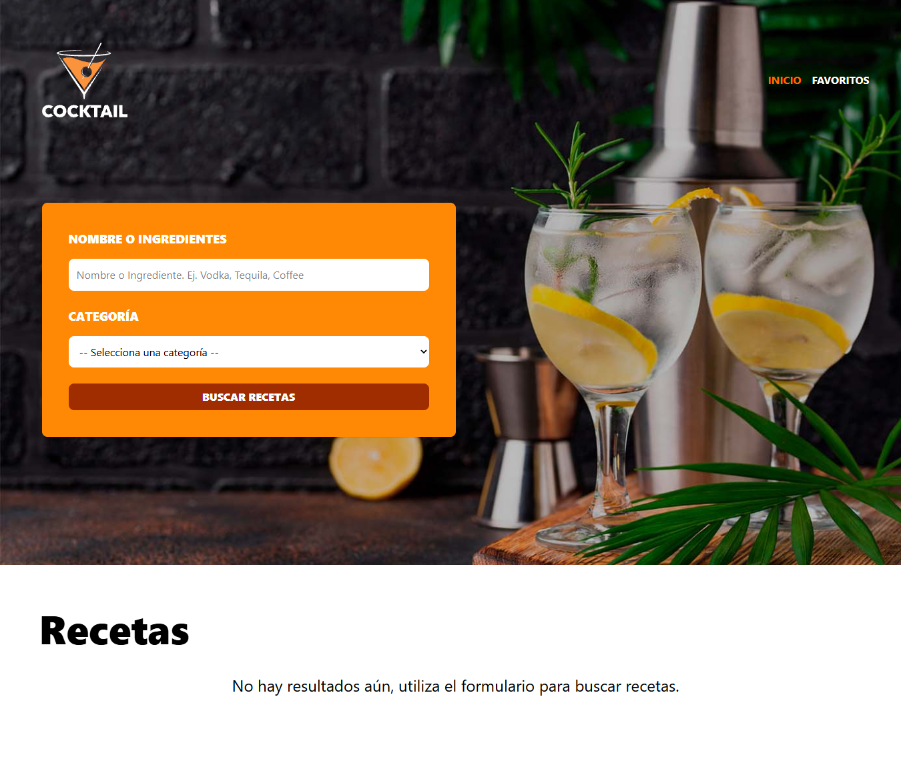
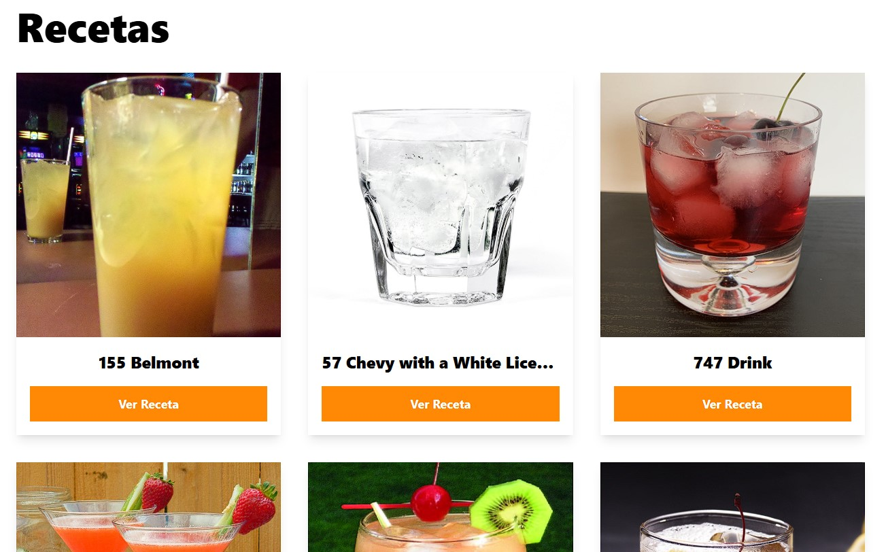
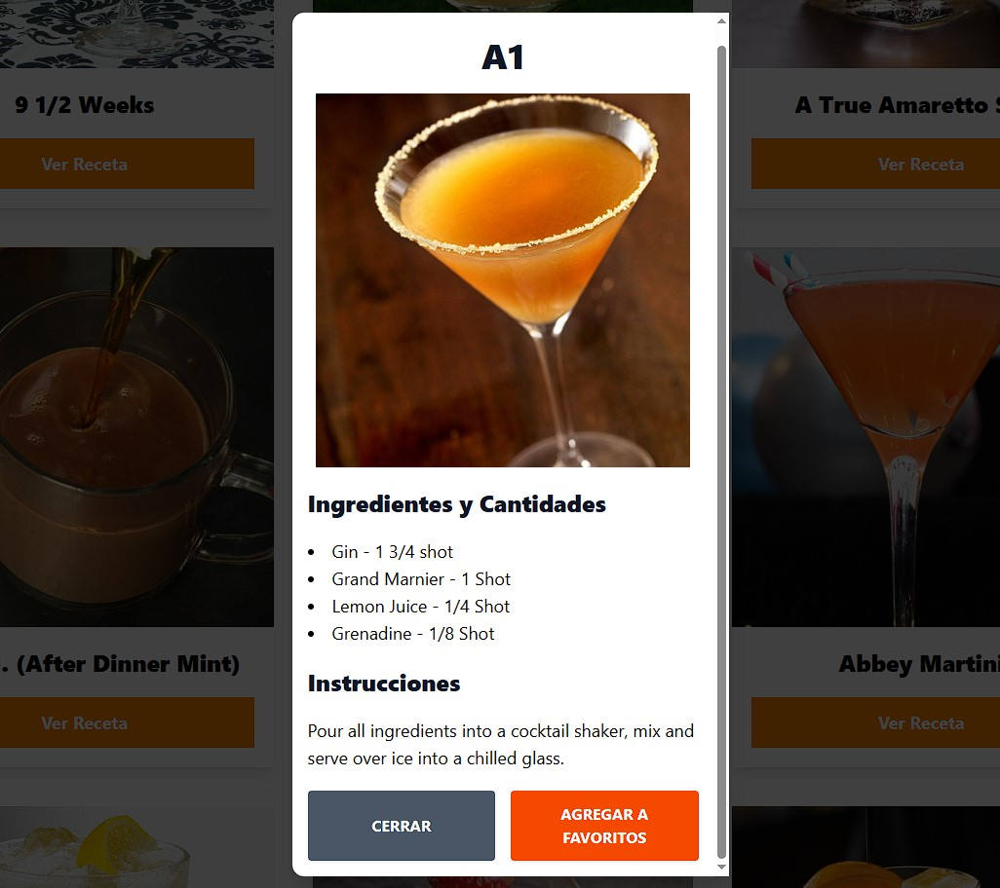
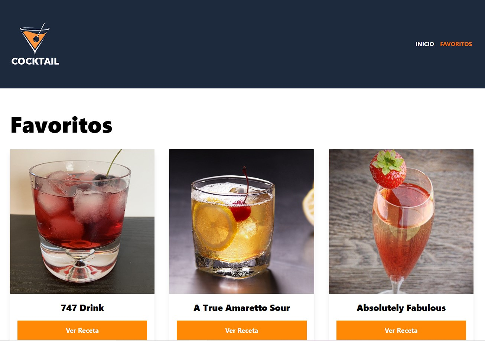

# Recetas Bebidas - React - Typescript 🍾​🍷​🍸​🍹​🍺​🥂​🍻​​

Consulta recetas de bebidas alcohólicas, dado un ingrediente y seleccionando una categoría.

Hecho con React - TypeScript, con las siguientes caracteristicas:

- Validación de todos los campos requeridos.
- Usa "react-router-dom" par ala rutas.
- Utiliza "axios" para consultas a la API.
- Usa "zustand" para el estado global (con Slice pattern).
- Utiliza "Zod" para validar las respuestas de la API.
- Usa TailwindCSS para los estilos.
- Utiliza "headlessui" para componentes de Modal.
- Usa "heroicons".
- Performance de archivos JS con "lazy" y "Suspense".
- Usa "localStorage" para conservar los favoritos.
- New: nueva página para generar recetas con IA.


## API Reference 🧩​

Para usar la API, no es necesario crear cuenta, se pueden consumir directamente los servicios de:

[The Cocktail DB](https://www.thecocktaildb.com/api.php)

Se usan los siguientes Endpoints:

#### Get Categories:

Obtener el listado de las categorias para buscar las bebidas:

```https
  https://www.thecocktaildb.com/api/json/v1/1/list.php?c=list
```

#### Get Recipes:

Obtener recetas, filtrando por categoria e ingrediente.

```https
  https://www.thecocktaildb.com/api/json/v1/1/filter.php?c=${filters.category}&i=${filters.ingredient}
```

#### Get Recipe By Id:

Obtener el detalle de la receta por un Id.

```https
  https://www.thecocktaildb.com/api/json/v1/1/lookup.php?i=${id}
```

#### Generar receta con IA:

Ir a [Openrouter](https://openrouter.ai/) registrarse y crear una API KEY (Copiarla).

Nota: Si al momento de hacer una consulta, el modelo falla, cambiarlo en el archivo "src\services\AIService.ts".

Para cambiar la personalidad del agente de IA, para que la respuesta sea diferente [Documentación](https://ai-sdk.dev/docs/reference/ai-sdk-core/stream-text).

## Run Server 🏃​

Para **desarrollo**: 

1) Instalar dependencias.

```bash
pnpm i
```

2) Crear en la raíz un archivo "**.env**", con la siguiente variable de entorno:

`VITE_OPENROUTER_KEY=api-key-de-openrouter`

3) Correr servidor con:

```bash
pnpm run dev
```
___

Para **producción**: 

1) Repetir pasos No.1 y No.2 de desarrollo.

2) Generar carpeta "dist" con:

```bash
pnpm run build
```

3) Subir carpeta "dist" al servidor.
    
## Dependencias ​👨‍💻

| Dependencia       | Descripción                                                        |
| ----------------- | ------------------------------------------------------------------ |
| [axios](https://www.npmjs.com/package/axios) | Cliente HTTP basado en promesas para el navegador y Node.js |
| [zod](https://www.npmjs.com/package/zod) | Para la validación de esquemas(schemas) basada en TypeScript con inferencia de tipos estática. |
| [@headlessui/react](https://headlessui.com/) | Componentes de interfaz de usuario totalmente accesibles y sin estilo, diseñados para integrarse a la perfección con Tailwind CSS. |
| [@heroicons/react](https://github.com/tailwindlabs/heroicons) | Hermosos iconos SVG hechos a mano por los creadores de Tailwind CSS |
| [zustand](https://www.npmjs.com/package/zustand) | Una solución de gestión de estado pequeña, rápida y escalable que utiliza principios Flux simplificados. |
| [react-router-dom](https://www.npmjs.com/package/react-router-dom) | React Router es un enrutador multiestrategia para React. Puedes usarlo como un framework de React o como una biblioteca con tu propia arquitectura. |
| [tailwindcss](https://www.npmjs.com/package/tailwindcss) | Un framework CSS centrado en la utilidad para crear rápidamente interfaces de usuario personalizadas. |
| [tailwindcss](https://www.npmjs.com/package/tailwindcss) | Un framework CSS centrado en la utilidad para crear rápidamente interfaces de usuario personalizadas. |
| [@openrouter/ai-sdk-provider](https://www.npmjs.com/package/@openrouter/ai-sdk-provider) | El proveedor OpenRouter para el SDK de IA de Vercel ofrece acceso a más de 300 modelos de lenguaje complejos en las API de chat y autocompletado de OpenRouter. |
| [ai](https://www.npmjs.com/package/ai) | El SDK de IA es un conjunto de herramientas TypeScript independiente del proveedor, diseñado para ayudarte a crear aplicaciones y agentes con inteligencia artificial utilizando marcos de interfaz de usuario populares como Next.js, React, Svelte, Vue, Angular y entornos de ejecución como Node.js. |

## Screenshots 📷​

 *Index Page*
 *Index Page | Recipes*
 *Recipe Detail - Modal*
 *Favorites Page*